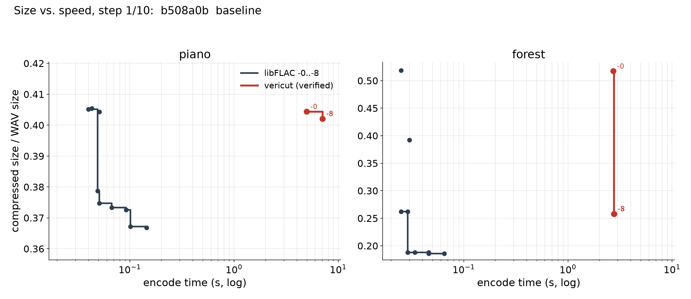
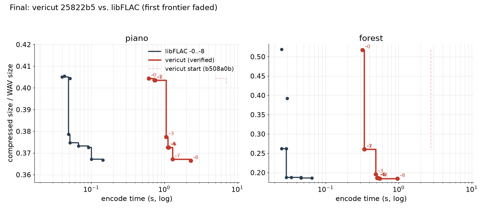
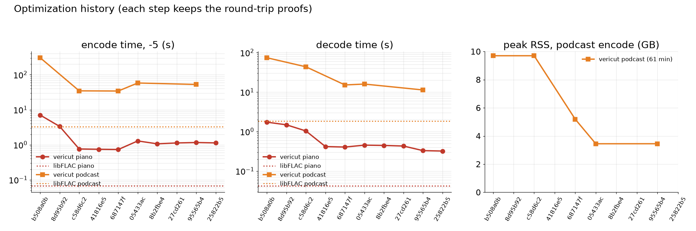

# Verified Cut

An audio splicer with a losless FLAC encoder and decoder written and proven \*correct in Lean 4.

```
core/     Lean 4 library and the `vericut` CLI (spec, FLAC codec, WAV, proofs)
app/      SwiftUI macOS editor that calls the CLI
tests/    end-to-end tests against libFLAC (`flac`) and ffmpeg, plus an axiom audit
bench/    benchmark script, results and plot
docs/     CLI contract, pipeline with trust boundaries, Tart VM for GUI tests
```

## Build, test, run (macOS)

```sh
brew install flac ffmpeg          # flac: reference codec for tests; ffmpeg: the app's imports
cd core && lake build             # proofs and the vericut binary (Lean v4.33.0, no Mathlib)
cd .. && python3 tests/test_vericut.py
cd app && swift run               # the editor; uses ../core/.lake/build/bin/vericut ($VERICUT_BIN overrides)
```

CLI contract: `docs/cli.md`. Pipeline, file by file: `docs/pipeline.md`.

> [!WARNING]
> QuickTime Player plays FLAC unreliably (libFLAC's files too). Use VLC, or convert to ALAC:
> `afconvert -f m4af -d alac out.flac out.m4a`.

## What is proven

Spec, [`core/VeriCut/Correctness.lean`](core/VeriCut/Correctness.lean) ([`flac_roundTrip`](core/VeriCut/Correctness.lean#L17), [`export_correct`](core/VeriCut/Correctness.lean#L24)):

```lean
theorem flac_roundTrip (st : Flac.Settings) (x : Pcm) (valid : x.Valid) :
    Flac.decode (Flac.encode st x) = .ok x                                    -- :17

theorem export_correct (st : Flac.Settings) (format : Format) (clips : List Clip)
    (valid : ∀ c ∈ clips, c.Valid format) (nonempty : clips ≠ [])
    (short : (clips.map fun c => c.stop - c.start).sum < 2 ^ 36) :
    Flac.decode (exportClips st format clips) = .ok (splice format clips)     -- :24
```

`Flac.encode` and `Flac.decode` are written to be read: a `Nat` bit writer, fixed predictors
only. The CLI runs the optimized codec in [`core/VeriCut/Flac/Fast/`](core/VeriCut/Flac/Fast/) (LPC, 64-bit writer,
streaming, MD5). [`core/VeriCut/CorrectnessFast.lean`](core/VeriCut/CorrectnessFast.lean) ([`decodeFast_eq`](core/VeriCut/CorrectnessFast.lean#L20), [`flac_roundTrip_fast`](core/VeriCut/CorrectnessFast.lean#L24), [`export_correct_fast`](core/VeriCut/CorrectnessFast.lean#L29)) ties it to the same spec `decode`, with
the same hypotheses:

```lean
theorem decodeFast_eq (d : ByteArray) : Flac.Fast.decodeFast d = Flac.decode d          -- :20

theorem flac_roundTrip_fast (st : Flac.Fast.Settings) (x : Pcm) (valid : x.Valid) :
    Flac.decode (Flac.Fast.encodeFast st x) = .ok x                                       -- :24

theorem export_correct_fast ... :   -- export_correct's hypotheses
    Flac.decode (exportClipsFast st format clips) = .ok (splice format clips)            -- :29
```

Definitions these mention: [`core/VeriCut/Spec/Audio.lean`](core/VeriCut/Spec/Audio.lean) (`Format`, `Pcm`, `Pcm.Valid`,
`Clip`, `Clip.Valid`, `splice`) and the spec decoder in [`core/VeriCut/Flac/`](core/VeriCut/Flac/) ([`Parse.lean`](core/VeriCut/Flac/Parse.lean)
reads a stream, [`Format.lean`](core/VeriCut/Flac/Format.lean) gives its meaning). [`Pcm.valid_of_validate`](core/VeriCut/Proofs/Splice.lean#L80) shows the CLI's
run-time check establishes `Pcm.Valid`. [`Examples.lean`](core/VeriCut/Examples.lean) discharges every hypothesis on concrete
audio. All five theorems use only `propext`, `Classical.choice`, `Quot.sound`, checked with
`#guard_msgs` in the build.

## Trusted, not proven

- That our bitstream is standard FLAC (RFC 9639). The theorems are about our own decoder.
  That libFLAC and ffmpeg decode our files bit-exact, and that we decode theirs, is tested.
- The STREAMINFO MD5. It is computed (`Flac/Fast/Md5.lean`) and matches libFLAC's, but no
  theorem mentions it.
- WAV parsing and writing (`Wav.lean`), file IO, JSON, the CLI glue in `Main.lean`.
- ffmpeg, which the app uses to convert other formats to WAV on import.
- The Swift app, its preview playback and its waveforms.
- Lean's compiler and runtime.

## Speed and size

Against libFLAC 1.5.0 (`bench/RESULTS-audio.md`, data in `bench/flac-optimization.csv`, plot
`bench/flac-optimization.png`): within 0.3 % of libFLAC's size at every level, 10-17x slower to
encode, about 8x slower to decode. A 61-minute podcast at -5 encodes in 52.7 s with 3.5 GB peak
RSS.

### Optimization

Each step below kept the round-trip and export theorems proven (spec unchanged; speedups live in
`Flac/Fast/` with equality proofs). The animation shows the size/speed Pareto frontier of
vericut levels -0..-8 per commit (red, earlier frontiers faded) against libFLAC -0..-8 (dark,
fixed). Commits before `95565b4` were benchmarked at levels 0/5/8 only.







Video version: `bench/pareto.mp4`. Regenerate with `uv run bench/plot_pareto.py`.
