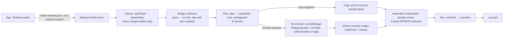

# Export pipeline

> Keep this in sync with the code: when a linked function moves or changes role, fix its link and line here in the same commit.

A cut list (`timeline.json`: clips, each `{path, in, out}` in display frames, half-open) becomes one MP4.
Everything runs in the Lean binary `smartcut` ([`core/Main.lean`](../core/Main.lean)); the app only runs it as a subprocess.

## Stages

**0. App entry.** [`Timeline.export`](../app/Sources/VerifiedCut/Model.swift#L89-L99) → [`SmartCut.export`](../app/Sources/VerifiedCut/SmartCut.swift#L116-L122) writes the timeline ([`writeTimeline`](../app/Sources/VerifiedCut/SmartCut.swift#L98-L108)) and runs `smartcut export … --encoder h264_videotoolbox --ffmpeg <path>` via [`run`](../app/Sources/VerifiedCut/SmartCut.swift#L31-L52). On import and every edit the app also calls `probe` and `plan` ([`add`](../app/Sources/VerifiedCut/Model.swift#L30-L41), [`refresh`](../app/Sources/VerifiedCut/Model.swift#L54-L66)) to show keyframes and the copy/re-encode counts.

**1. Orchestration.** [`doExport`](../core/Main.lean#L116-L203) parses the timeline ([`parseTimeline`](../core/Main.lean#L25-L29)), and for each clip: demux, check constant frame rate and that size/codec match the first clip, plan, then render each segment. ⚠ Stages 4–5 live inline in this one loop, not as separate functions.

**2. Demux.** [`loadTrack`](../core/Main.lean#L35-L39) reads the whole file, [`parseVideo`](../core/SmartCut/MP4/Parse.lean#L157-L163) → [`parseTrack`](../core/SmartCut/MP4/Parse.lean#L81-L154) reads the first video track's sample tables (offsets, sizes, dts/cts, sync flags, raw `stsd` entry). Frame bytes are never inspected. [`displayRanks`](../core/SmartCut/MP4/Parse.lean#L189-L194) turns cts into display positions.

**3. Bridge to the model.** [`toStream`](../core/SmartCut/MP4/Parse.lean#L202-L205) builds the abstract `Stream`: a sync sample has no references, every other sample references the previous one in decode order. Trusted: `stss` marks only decoder-resetting (closed-GOP) samples.

**4. Plan (copy vs re-encode).** [`planClip`](../core/Main.lean#L58-L63) checks the range and calls [`plan`](../core/SmartCut/Impl/Planner.lean#L50-L52): [`copyTable`](../core/SmartCut/Impl/Planner.lean#L19-L21) marks frames that are wanted and whose references are all copyable, [`displayOrder`](../core/SmartCut/Impl/Planner.lean#L37-L39) + [`runs`](../core/SmartCut/Impl/Planner.lean#L24-L30) split the wanted frames into maximal copy/encode runs, [`mkSegment`](../core/SmartCut/Impl/Planner.lean#L43-L47) emits `copy` (decode order) or `encode` (display order) segments. In practice: a wanted frame is copied iff the decode-order chain back to its keyframe stays inside the range, so typically the head before the first keyframe in the range is re-encoded and the rest copied.

**5a. Copy segments.** In [`doExport`](../core/Main.lean#L162-L174): each sample becomes an `OutSample` pointing at the source bytes, with a new display slot; with `--paramsets inband` the source SPS/PPS ([`avcParamSets`](../core/SmartCut/MP4/Parse.lean#L168-L186)) are prepended when they differ from the active ones.

**5b. Re-encode segments.** In [`doExport`](../core/Main.lean#L175-L196) → [`encodeRange`](../core/Main.lean#L95-L114): one `ffmpeg` process per segment decodes the source and selects display frames `[a, b]` (`select=between(n,a,b)`), encodes them to a temp MP4, which is demuxed again with `loadTrack` and checked (frame count, codec, no B-frame reordering, starts with a sync sample). Its samples become `OutSample`s; its `stsd` entry is added as a new sample description (default) or its SPS/PPS go in-band.

**6. Mux.** [`writeFile`](../core/SmartCut/MP4/Write.lean#L101-L123) writes `ftyp`, one `mdat` (source byte ranges copied, merged when contiguous), then [`moovBox`](../core/SmartCut/MP4/Write.lean#L58-L94), which rebuilds all timing from scratch (constant `dur`, cts from display slots, edit list hides the reorder delay).

## Proven vs trusted

| Part | Status |
|---|---|
| [`plan`](../core/SmartCut/Impl/Planner.lean#L50-L52) | ✅ [`plan_valid`](../core/SmartCut/Proofs/Impl.lean#L92), [`plan_covers`](../core/SmartCut/Proofs/Impl.lean#L118), [`plan_copy_copyable`](../core/SmartCut/Proofs/Impl.lean#L148); copies the most possible ([`copyable_maximal`](../core/SmartCut/Proofs/Planner.lean#L54)) |
| Abstract export [`exportPlan`](../core/SmartCut/Spec/Export.lean#L53-L55) | ✅ [`export_correct`](../core/SmartCut/Proofs/Export.lean#L65), [`export_exact`](../core/SmartCut/Proofs/Export.lean#L85): for any codec and any encoder meeting the [`Encoder`](../core/SmartCut/Spec/Export.lean#L39-L42) contract, the export decodes to the wanted pictures (`approx` on re-encoded ones) |
| [`toStream`](../core/SmartCut/MP4/Parse.lean#L202-L205) | trusted modelling assumption (closed GOPs; decoder is a function of bytes + references) |
| Encoder contract, `approx` | trusted, `approx` still abstract |
| `doExport` segment rendering, `OutSample`/display slots, in-band parameter sets | ⚠ unverified: the concrete counterpart of `exportPlan` is hand-written, not proven equal to it |
| Demux (`MP4/Parse.lean`), mux (`MP4/Write.lean`, `Bytes.lean`) | unverified, tested against ffprobe/ffmpeg in [`tests/test_smartcut.py`](../tests/test_smartcut.py) |
| ffmpeg (decode + encode), VideoToolbox, Swift app | unverified external code |

## Where encoders and decoders are called

- **Only in [`encodeRange`](../core/Main.lean#L95-L114)**, only for `encode` segments. It runs the `ffmpeg` binary (path from `--ffmpeg`; the app finds Homebrew's, [`SmartCut.ffmpeg`](../app/Sources/VerifiedCut/SmartCut.swift#L24-L29)).
  - **Decode:** ffmpeg's own software decoder (no `-hwaccel`), all source frames up to `b`, `-ignore_editlist 1`.
  - **Encode:** `-c:v <encoder>`. The app passes `h264_videotoolbox` ([`SmartCut.export`](../app/Sources/VerifiedCut/SmartCut.swift#L117)) — Apple's hardware H.264 encoder via ffmpeg, args from [`defaultArgs`](../core/Main.lean#L86-L89): `-q:v 75 -bf 0 -allow_sw 0` (hardware only, no B-frames). The CLI default is `libx264` (`-preset veryfast -crf 16 -bf 0`).
  - Copy segments never touch a codec: their bytes are copied by `writeFile`.
- **AVFoundation** is used only for the app's preview player ([`rebuildPreview`](../app/Sources/VerifiedCut/Model.swift#L69-L87), an `AVMutableComposition`), not for export.
