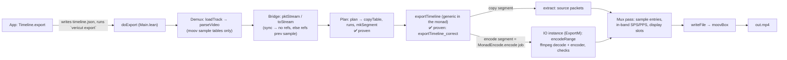

# Export pipeline

> Keep this in sync with the code: when a linked function moves or changes role, fix its link and line here in the same commit.

A cut list (`timeline.json`: clips, each `{path, in, out}` in display frames, half-open) becomes one MP4.
Everything runs in the Lean binary `vericut` ([`core/Main.lean`](../core/Main.lean)); the app only runs it as a subprocess.

The export loop is written once, [`exportTimeline`](../core/VeriCut/Impl/Export.lean#L40-L41), against a one-method class [`MonadEncode`](../core/VeriCut/Impl/Export.lean#L16-L17) (`encode : Job → m (Stream α)`). The CLI runs it in `IO` (`ExportM`, encoder = ffmpeg); the proof runs the *same definition* in [`PureEncode`](../core/VeriCut/Impl/Export.lean#L43-L47) (`ReaderT (Job → Stream α) Id`, encoder = an arbitrary function `f`) and shows it is correct for every `f` meeting the per-job contract.

## Stages

**0. App entry.** [`Timeline.export`](../app/Sources/VerifiedCut/Model.swift#L89-L99) → [`VeriCut.export`](../app/Sources/VerifiedCut/VeriCut.swift#L116-L122) writes the timeline ([`writeTimeline`](../app/Sources/VerifiedCut/VeriCut.swift#L98-L108)) and runs `vericut export … --encoder h264_videotoolbox --ffmpeg <path>` via [`run`](../app/Sources/VerifiedCut/VeriCut.swift#L31-L52). On import and every edit the app also calls `probe` and `plan` ([`add`](../app/Sources/VerifiedCut/Model.swift#L30-L41), [`refresh`](../app/Sources/VerifiedCut/Model.swift#L54-L66)) to show keyframes and the copy/re-encode counts.

**1. Load and plan.** [`doExport`](../core/Main.lean#L194-L282) parses the timeline ([`parseTimeline`](../core/Main.lean#L26-L30)), then for every clip ([loop](../core/Main.lean#L198-L223)): demux, check constant frame rate and that size/codec match the first clip, build its packet stream, plan it. All clips are loaded and planned before any encoding starts.

**2. Demux.** [`loadTrack`](../core/Main.lean#L36-L40) reads the whole file, [`parseVideo`](../core/VeriCut/MP4/Parse.lean#L157-L163) → [`parseTrack`](../core/VeriCut/MP4/Parse.lean#L81-L154) reads the first video track's sample tables (offsets, sizes, dts/cts, sync flags, raw `stsd` entry). Frame bytes are never inspected. [`displayRanks`](../core/VeriCut/MP4/Parse.lean#L189-L194) turns cts into display positions.

**3. Bridge to the model.** [`toStream`](../core/VeriCut/MP4/Parse.lean#L202-L205) builds the abstract `Stream`: a sync sample has no references, every other sample references the previous one in decode order. [`pktStream`](../core/Main.lean#L161-L165) is the same stream with each packet's data replaced by a `Pkt` (buffer, offset, size, sync, sample entry), so the exporter's packets say where their bytes are. Trusted: `stss` marks only decoder-resetting (closed-GOP) samples. Proven: the stream is well-formed when sample 0 is sync ([`toStream_wellFormed`](../core/VeriCut/Proofs/Bridge.lean#L14), checked by `planClip`).

**4. Plan (copy vs re-encode).** [`planClip`](../core/Main.lean#L60-L66) checks the range and calls [`plan`](../core/VeriCut/Impl/Planner.lean#L63-L66): [`copyTable`](../core/VeriCut/Impl/Planner.lean#L26-L28) marks frames that are wanted and whose references are all copyable, [`displayOrder`](../core/VeriCut/Impl/Planner.lean#L45-L47) + [`runs`](../core/VeriCut/Impl/Planner.lean#L31-L37) split the wanted frames into maximal copy/encode runs, [`mkSegment`](../core/VeriCut/Impl/Planner.lean#L55-L60) emits `copy` (decode order) or `encode` (display order) segments. Each `encode` segment is one encoder job.

**5. Render: [`exportTimeline`](../core/VeriCut/Impl/Export.lean#L25-L41)** ([called here](../core/Main.lean#L224-L226)). Per segment, [`renderSegment`](../core/VeriCut/Impl/Export.lean#L26-L28): `copy ks` → `extract s ks` (the source packets, references renumbered; computed by `extractA` on the array, proven equal); `encode ks` → `MonadEncode.encode ⟨clip, ks⟩`. In the CLI that is the [`ExportM` instance](../core/Main.lean#L177-L192) → [`encodeRange`](../core/Main.lean#L119-L146): one `ffmpeg` process decodes the source and selects display frames `[a, b]` (`select=between(n,a,b)`), encodes them to a temp MP4, which is demuxed again with `loadTrack` and checked (frame count, codec, no B-frame reordering, starts with a sync sample). Its bytes are appended to the buffer list; its samples come back as a `pktStream` whose display positions are `a + k`. `--strict` fails here.

**6. Mux pass.** In [`doExport`](../core/Main.lean#L227-L278): walks clips × segments × rendered packets and turns them into `OutSample`s: display slot `base + pts - in`, sample-description index (default: one per distinct `stsd` entry), or with `--paramsets inband` prepends SPS/PPS ([`avcParamSets`](../core/VeriCut/MP4/Parse.lean#L168-L186)) where the active set changes.

**7. Write.** [`writeFile`](../core/VeriCut/MP4/Write.lean#L101-L123) writes `ftyp`, one `mdat` (source byte ranges copied, merged when contiguous), then [`moovBox`](../core/VeriCut/MP4/Write.lean#L58-L94), which rebuilds all timing from scratch (constant `dur`, cts from display slots, edit list hides the reorder delay).

## Proven vs trusted

| Part | Status |
|---|---|
| [`plan`](../core/VeriCut/Impl/Planner.lean#L63-L66) | ✅ [`plan_valid`](../core/VeriCut/Proofs/Impl.lean#L131), [`plan_covers`](../core/VeriCut/Proofs/Impl.lean#L160), [`plan_copy_copyable`](../core/VeriCut/Proofs/Impl.lean#L193); copies the most possible ([`copyable_maximal`](../core/VeriCut/Proofs/Planner.lean#L64)) |
| [`exportTimeline`](../core/VeriCut/Impl/Export.lean#L40-L41), the loop the CLI runs | ✅ [`exportTimeline_correct`](../core/VeriCut/Proofs/Run.lean#L116): run on the planner's plans with any encoder function `f` meeting [`JobContract`](../core/VeriCut/Spec/Export.lean#L73-L75) on each job, the concatenated output decodes to the requested pictures of every clip, in timeline order (exact for copies, `approx` for re-encodes) |
| Abstract export [`exportPlan`](../core/VeriCut/Spec/Export.lean#L53-L55) | ✅ [`export_correct`](../core/VeriCut/Proofs/Export.lean#L67), [`export_exact`](../core/VeriCut/Proofs/Export.lean#L87) (single clip, `Encoder` record) |
| [`toStream`](../core/VeriCut/MP4/Parse.lean#L202-L205) | trusted modelling assumption (closed GOPs; decoder is a function of bytes + references); well-formedness proven ([`toStream_wellFormed`](../core/VeriCut/Proofs/Bridge.lean#L14)) |
| `ExportM` encode instance: ffmpeg output meets `JobContract` | trusted (encoder contract, `approx` still abstract); `encodeRange` checks frame count, codec, no reordering, leading sync |
| `pktStream` (data relabelling), mux pass (`OutSample`s, display slots, sample entries, in-band parameter sets) | ⚠ unverified, tested: not modelled by the proofs, which stop at the packet stream |
| Demux (`MP4/Parse.lean`), mux (`MP4/Write.lean`, `Bytes.lean`) | unverified, tested against ffprobe/ffmpeg in [`tests/test_vericut.py`](../tests/test_vericut.py) |
| ffmpeg (decode + encode), VideoToolbox, Swift app | unverified external code |

## Where encoders and decoders are called

- **Only in [`encodeRange`](../core/Main.lean#L119-L146)**, only for `encode` segments. It runs the `ffmpeg` binary (path from `--ffmpeg`; the app finds Homebrew's, [`VeriCut.ffmpeg`](../app/Sources/VerifiedCut/VeriCut.swift#L24-L29)).
  - **Decode:** ffmpeg's own software decoder (no `-hwaccel`), all source frames up to `b`, `-ignore_editlist 1`.
  - **Encode:** `-c:v <encoder>`. The app passes `h264_videotoolbox` ([`VeriCut.export`](../app/Sources/VerifiedCut/VeriCut.swift#L117)) — Apple's hardware H.264 encoder via ffmpeg, args from [`defaultArgs`](../core/Main.lean#L89-L92): `-q:v 75 -bf 0 -allow_sw 0` (hardware only, no B-frames). The CLI default is `libx264` (`-preset veryfast -crf 16 -bf 0`).
  - Copy segments never touch a codec: their bytes are copied by `writeFile`.
- **AVFoundation** is used only for the app's preview player ([`rebuildPreview`](../app/Sources/VerifiedCut/Model.swift#L69-L87), an `AVMutableComposition`), not for export.
